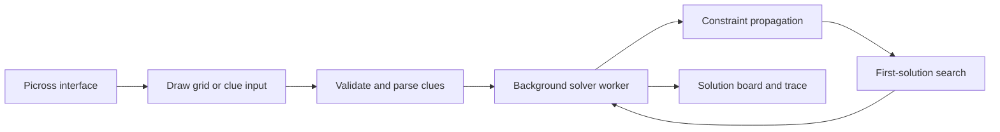

# Picross Solver

A browser-based Picross (Nonogram) solver. Draw a pixel design to generate clues automatically, or enter row and column clues yourself. The solver searches for a valid board and displays its reasoning trace.

## Features

- Create puzzles from **5 x 5 to 15 x 15**.
- Draw and erase cells, then generate clues from your design.
- Enter clues directly when you already have a puzzle.
- Solve in a background Web Worker so the interface remains responsive.
- Switch between light and dark themes; the choice is remembered.
- View solver statistics and a step trace.

## Run Locally

Open `index.html` in a modern browser. For reliable Web Worker support, serve the folder over HTTP, for example with VS Code Live Server or `python -m http.server`.

## Architecture

## Deploy

The project is static and can be hosted with GitHub Pages. Select the repository root as the Pages source.

## Tech

Vanilla HTML, CSS, and JavaScript. No build step or runtime dependencies.
